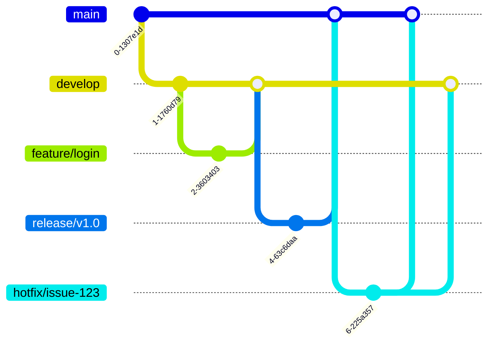

# aula09

Projeto em **Java 17 + Maven** da **Aula 09 - Versionamento e Git Avançado**, contemplando o fluxo completo de **Git Flow**, **GitHub Actions (CI/CD + Javadoc)**, **Code Review** e **Testes Unitários com JUnit 5 e JaCoCo**.

---

## Fluxo Git Flow Executado



---

## Estrutura do Projeto Java

- `src/main/java/br/com/aula09/model/Usuario.java` — Modelo de domínio do usuário (`id`, `name`, `email`, `phone`)
- `src/main/java/br/com/aula09/service/UserService.java` — Gerenciamento de usuários (`carregarUsuarios`, `getTotalUsuarios`, `usuarioPorId`, `usuariosComEmailBiz`, `limparUsuarios`, `formatarHeader`)
- `src/main/java/br/com/aula09/service/LoginService.java` — Validação de senha implementada na branch `feature/login` (Atividade 1)
- `src/main/java/br/com/aula09/service/Calculadora.java` — Classe revisada com tratamento de divisão por zero (`ArithmeticException`) (Atividade 3)
- `src/main/java/br/com/aula09/service/NotificacaoService.java` — Serviço com `enviarEmail()` e validação de e-mail via Regex (Desafio Colaborativo)
- `.github/workflows/pr-validation.yml` — Workflow de validação automática com JDK 17 e `mvn clean test` (Atividade 2)
- `.github/workflows/javadoc.yml` — Workflow para geração automática de Javadoc

---

## Como Executar os Testes e o Build

```bash
# Executar todos os testes unitários e relatório de cobertura JaCoCo
mvn clean test

# Gerar documentação Javadoc
mvn javadoc:javadoc
```
